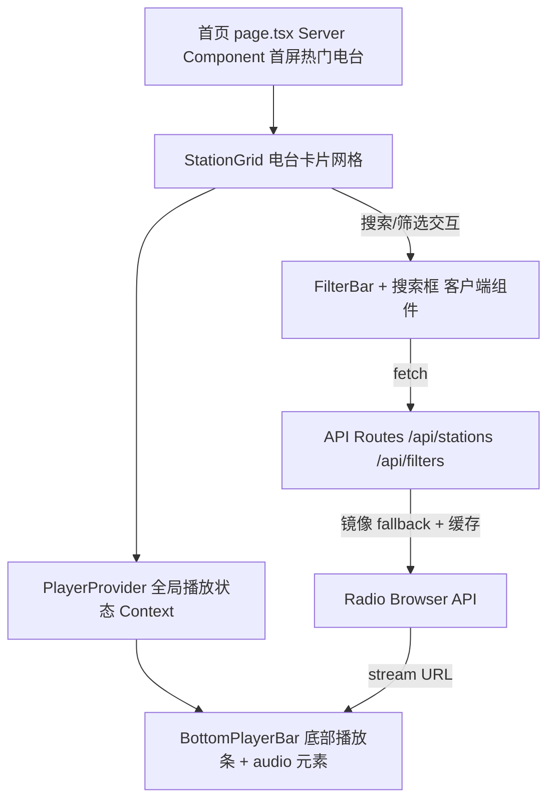

## 产品概述

复刻 App Store 应用「Radioo收音机：FM全球广播电台」（官网 radioo.cn）的最小可用网页版，在网页上实现"发现并收听全球电台"的核心体验，先验证体验再迭代。

**【新增需求 2026-11-24】页面必须支持手机端访问，体验要像原生 App 一样**——移动端优先适配，触摸友好，可"添加到主屏幕"全屏运行。

## 核心功能（MVP 范围）

- **首页电台浏览**：展示热门/推荐电台列表（按收听量排序），带电台名称、国家国旗、类型标签、清晰度标识
- **筛选浏览**：按国家（Country）、语言（Language）、类型/流派（Tag，如 Pop/News/Jazz）筛选电台
- **搜索**：按电台名称关键词搜索
- **点击播放**：点击电台卡片即通过 HTML5 Audio 播放该电台音频流，支持播放/暂停、音量控制
- **底部固定播放条**：常驻底部显示当前播放电台（名称/国旗/类型）与播放控制，切换电台即时响应；移动端呈迷你播放条样式
- **加载与错误反馈**：播放连接中状态提示、流失效提示、列表加载骨架/空态

## 明确不做（本期范围外）

收藏/文件夹/历史、睡眠定时、迷你悬浮播放器、now-playing 曲目显示、实时字幕翻译、歌曲识别、Apple 生态功能（Watch/CarPlay/小组件/Siri）

## 移动端 App 化适配（新增）

- **PWA 轻量化**：添加 `app/manifest.ts`（应用名、图标、`display: standalone`、主题色），支持手机"添加到主屏幕"后全屏运行、无浏览器地址栏，观感接近原生 App
- **移动优先布局**：响应式网格（手机 1-2 列），筛选栏移动端改为横向滚动 chips 或折叠式，避免横向溢出
- **视口与安全区**：`viewport-fit=cover` + `env(safe-area-inset-*)` 适配刘海屏/底部手势条；底部播放条加 padding 贴合 iOS 底部安全区
- **触摸规范**：所有可点目标 ≥ 44×44px 触摸热区；禁用双击缩放歧义（`touch-action: manipulation`）；不依赖 hover 传达关键信息（hover 效果在触屏降级为激活态）
- **播放策略**：播放均由用户点击触发（符合移动端自动播放限制）；后台播放依赖 Media Session API（锁屏/通知栏显示电台名与控制按钮）
- **性能**：字体系统栈优先、骨架屏占位、图片懒加载，保证移动网络下首屏可用

## Tech Stack

- **框架**：Next.js 15（App Router）+ TypeScript，与用户既有 myweixinmp 项目技术栈一致，便于后续接后端/部署 ECS
- **样式**：Tailwind CSS v4，自定义深色主题 token
- **数据源**：Radio Browser 开放 API（免费、无需 key；官方镜像 all.api.radio-browser.info 系列，支持 `/json/stations/search` 按 name/countrycode/language/tag 过滤，order=clickcount/votes 排序，hidebroken=true 过滤失效流）
- **状态管理**：React hooks + Context（播放器全局状态），无需引入重型状态库

## Implementation Approach

- **API 代理**：前端不直连 Radio Browser，通过 Next.js Route Handler（`/api/stations`、`/api/filters`）服务端代理请求——规避 CORS/网络波动，便于统一缓存（`revalidate`）与后续换源
- **播放方案**：全局单例 `<audio>` 元素挂载在根布局的 PlayerProvider 中，点击卡片仅更新 storeContext（station + src），避免组件重挂载导致播放中断；音频流浏览器直连（电台流无 CORS 限制）
- **性能**：首页列表服务端渲染首屏（Server Component + fetch 缓存），筛选/搜索客户端请求代理路由；每页限 50 条避免大 payload；防抖搜索（300ms）
- **可靠性**：Radio Browser 多镜像 fallback（all.api → de1.api → nl1.api）；流播放失败（onError/超时）提示"电台暂时不可用"；请求超时与错误统一处理
- **避免过度设计**：MVP 不建数据库、不做登录，纯公开 API + 前端状态，收藏等功能留待迭代时再引入存储层

## Architecture Design



## Directory Structure

```
d:/projects/myradio/
├── package.json                  # [NEW] Next.js 15 + React 19 + TypeScript + Tailwind v4
├── next.config.ts                # [NEW] 基础配置
├── tsconfig.json                 # [NEW] TS 配置（create-next-app 生成）
├── src/
│   ├── app/
│   │   ├── layout.tsx            # [NEW] 根布局：深色主题、viewport/safe-area、PlayerProvider、BottomPlayerBar
│   │   ├── manifest.ts           # [NEW] PWA manifest：standalone 模式、图标、主题色（移动端 App 化）
│   │   ├── icon.svg              # [NEW] 应用图标（PWA 用）
│   │   ├── page.tsx              # [NEW] 首页：服务端首屏热门电台 + 客户端筛选/搜索区
│   │   ├── globals.css           # [NEW] Tailwind 引入 + 深色主题变量 + safe-area + reduced-motion 降级
│   │   └── api/
│   │       ├── stations/route.ts # [NEW] 电台代理：name/countrycode/language/tag/order/limit 参数转发
│   │       └── filters/route.ts  # [NEW] 国家/语言/类型列表代理（供筛选器选项）
│   ├── components/
│   │   ├── StationCard.tsx       # [NEW] 电台卡片（名称/国旗/标签/点击播放，键盘可达，≥44px 触摸热区）
│   │   ├── StationGrid.tsx       # [NEW] 卡片网格 + 加载骨架/空态
│   │   ├── FilterBar.tsx         # [NEW] 搜索框 + 国家/语言/类型下拉筛选（移动端 chips/折叠，role=listbox + aria）
│   │   └── BottomPlayerBar.tsx   # [NEW] 底部播放条：播放/暂停、音量（移动端迷你条）、Media Session 元数据、safe-area padding
│   ├── lib/
│   │   ├── radio-browser.ts      # [NEW] Radio Browser 客户端：镜像 fallback、超时、类型映射
│   │   └── player-context.tsx    # [NEW] 播放器全局状态：当前电台/播放中/audio 单例/音量
│   └── types/
│       └── station.ts            # [NEW] Station、FilterOption 等类型定义
```

## 设计风格

深色现代风（类原 App Radioo 观感）：深色沉浸背景 + 靛蓝/青色点缀，电台卡片化呈现，大播放按钮，克制微动效。移动端优先设计（手机上观感最接近原生 App）。整体遵循 vercel-labs web-interface-guidelines（实施时用 [skill:web-design-guidelines] 审查）。

## 页面结构（单页）

- **顶栏**：应用名「Radioo Web」+ 简短说明，右侧为全局搜索框（防抖、清空按钮）；移动端顶栏收紧
- **筛选栏**：国家/语言/类型三个下拉筛选（自定义下拉需 role=listbox/option、aria-expanded、Escape 关闭回焦点）+ 「清除筛选」按钮；激活时选项计数反馈；移动端改横向滚动 chips
- **电台网格**：响应式卡片（移动 1-2 列 → 平板 2-3 列 → 桌面 4 列）；卡片含电台 favicon（失败回退首字母圆形占位）、名称、国旗 emoji、类型标签、收听量；hover 显式 transition（color/background/transform，禁 transition-all）；触屏无 hover 时有激活态反馈；点击卡片即播放，当前播放卡片高亮描边 + 播放中图标动画（reduced-motion 下静态）
- **底部播放条**：固定底栏，含当前电台信息、播放/暂停大按钮（aria-label，≥44px）、音量滑块（aria-valuetext，移动端可省略为系统音量）；加载中转圈、流失效行内错误提示；未选台时显示引导空态；贴合底部 safe-area
- **状态反馈**：列表骨架屏、搜索无结果空态、播放错误 toast/行内提示；所有交互元素 focus-visible 焦点环，文字对比度 ≥ AA

## Agent Extensions

### Skill

- **web-design-guidelines**
- Purpose: 实施完成后对 UI 代码做 Web Interface Guidelines 合规审查（可访问性、交互、样式、性能规则）
- Expected outcome: 以 file:line 格式输出违规项并修复；raw 源在本环境不可达时沿用已掌握的核心规则清单（禁 transition-all、aria 属性、focus-visible、reduced-motion、AA 对比度等）执行审查